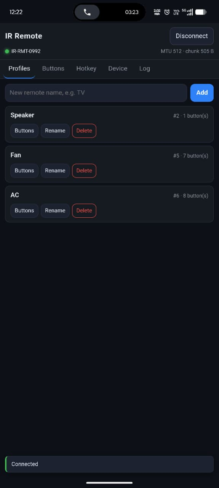
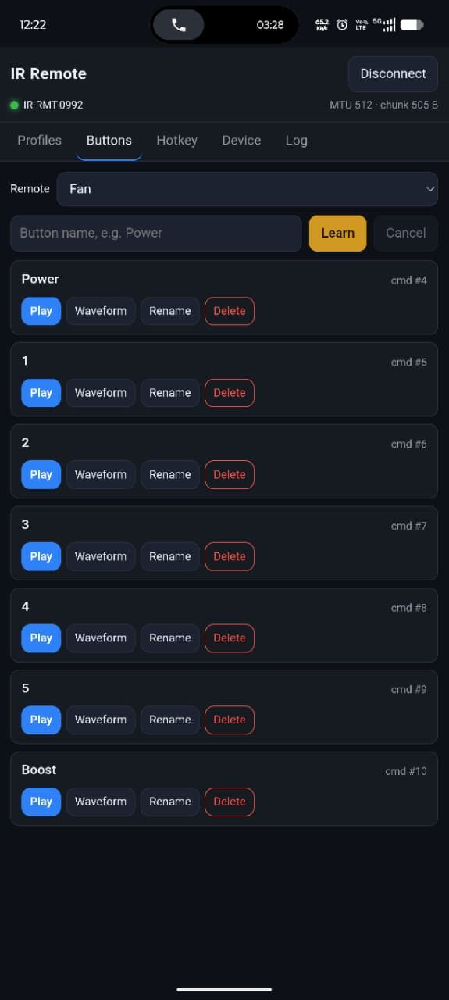
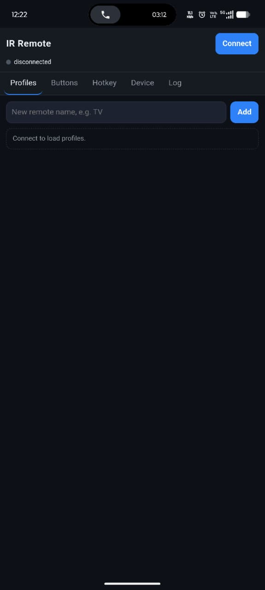
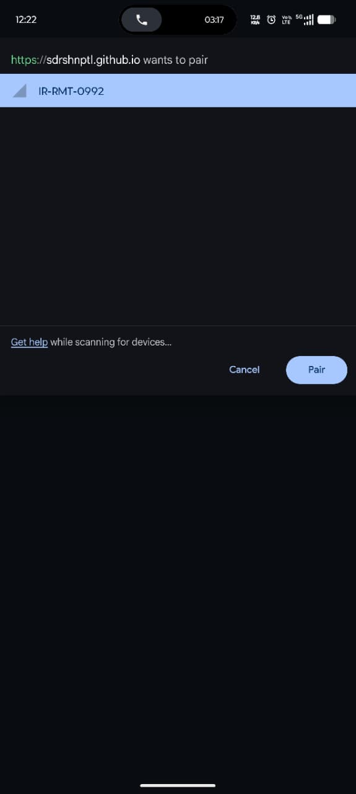

# ESP32-C3 Universal IR Remote

A handheld-sized IR remote that **learns any infrared remote** and plays it back — controlled from
your phone browser over Bluetooth. No app to install, no Wi-Fi, no cloud.

You point an existing remote at it, press a button, and the device records the raw infrared
waveform. Later you press **Play** in the dashboard and it reproduces that waveform through an IR
LED, so the TV/fan/AC reacts exactly as if the original remote had been used.

```
  original remote ──IR──▶ [ IR receiver ] ──▶ ESP32-C3 ──BLE──▶ phone browser
                                                  │                    │
                                                  │◀───── Play ────────┘
                                                  ▼
      TV / fan / AC ◀──────────IR────────── [ IR LED + driver ]
```

Because the firmware records raw timings instead of decoding a protocol, it works with remotes it
has never heard of — NEC, RC5, Samsung, Daikin AC frames, ceiling fans, anything a 38 kHz receiver
can see. Nothing about the remote is hardcoded.

---

## 1. What you get

| Feature | How it behaves |
|---|---|
| Learn | One press of a remote button is captured as a list of microsecond-level mark/space durations |
| Organise | Profiles (e.g. *TV*, *Fan*, *AC*) each hold up to 32 buttons; 16 profiles, stored in flash |
| Play | Any stored button is replayed with a 38 kHz carrier, with optional repeats |
| Inspect | The dashboard draws the captured waveform so you can see what was recorded |
| Configure | Repeats per playback; carrier frequency, duty cycle and repeat gap are stored with every command (38 kHz / 33 % by default) |
| Hotkey | A sequence of up to 8 commands with per-step delay/repeats can be stored and tested |
| Control | Chrome on Android talks to it over Web Bluetooth; the UI is a static page on GitHub Pages |
| Status | The onboard blue LED shows advertising, connected, learning, capture OK and errors |

<p align="center">
  
  
</p>

---

## 2. How it works (the 60-second version)

| Stage | What happens |
|---|---|
| **Receive** | A demodulating receiver (TSOP/VS1838 class) outputs a clean envelope: idle **high**, low while a 38 kHz burst is present. The ESP32-C3 RMT peripheral samples that line at 1 MHz, so one tick = 1 µs. |
| **Capture** | `ir_capture` turns the symbol stream into `start_level` + `durations[]` (µs), rejects duplicates (so holding a key does not create five buttons), and reports the frame. |
| **Store** | Metadata (profiles, buttons, hotkey, playback parameters) lives in **NVS**; the raw frame blobs live in a **SPIFFS** partition. Both are written through a single `ir_store` API, so a power cut cannot leave the two out of sync. |
| **Transport** | `ble_link` is a NimBLE peripheral that moves *framed byte buffers* only. `protocol` speaks JSON-RPC on top of it: `{"id":17,"cmd":"button.play","args":{…}}`. |
| **Play** | `ir_playback` rebuilds the recorded envelope into RMT symbols and transmits it with a 38 kHz carrier (33 % duty) through a transistor driving the IR LED. |
| **Control** | `docs/` is a dependency-free static web app. GitHub Pages serves it over HTTPS; the phone connects straight to the device with Web Bluetooth. **The device itself has no Wi-Fi and no web server.** |

Learning is deliberately **asynchronous**: `button.learn` returns immediately, the LED starts
blinking at 5 Hz, and when you press the remote the answer arrives as a `button.learned` event.
A session captures a single press — arm it again for the next button.

---

## 3. Bill of materials

| Qty | Part | Notes |
|---|---|---|
| 1 | **ESP32-C3 SuperMini** | 4 MB flash assumed (the default partition table); 2 MB parts are supported |
| 1 | **38 kHz IR receiver** — VS1838B, TSOP312 | 3 legs: OUT / GND / VCC, 3.3 V capable. Must be a *demodulating* receiver, not a bare photodiode. A TSOP1738 is a 5 V-only part — see the note below |
| 1 | **IR LED, 940 nm** | The emitter. Never drive it from a GPIO pin directly |
| 1 | **2N2222 NPN transistor** | Low-side switch for the IR LED |
| 1 | Resistor **1 kΩ** | Transistor base resistor |
| 1 | Resistor **33 Ω** | IR LED series resistor |
| 1 | Momentary push-button *(optional)* | Hotkey input on GPIO0 |
| — | Breadboard + jumper wires, USB-C cable | Power comes from the SuperMini's USB port |

The two resistors are not drawn in the schematic below; fit them anyway. They are what keeps the
GPIO pin, the transistor and the LED inside their ratings.

---

## 4. Wiring


The diagram shows every connection of the circuit. Match the wire colours to the table. Note that the
drawing ties the IR LED anode straight to 3V3 — insert the **33 Ω** resistor in that leg and the
**1 kΩ** resistor in the base leg:

| Wire | From (ESP32-C3 SuperMini) | To | Purpose |
|---|---|---|---|
| 🟣 Purple | **3V3** pad | Receiver **VCC** *and* IR LED **anode** (through the 33 Ω resistor) | 3.3 V rail |
| 🔵 Dark blue | **G** pad | Receiver **GND** *and* transistor **emitter** | Common ground |
| 🟢 Green | **GPIO4** pad | Receiver **OUT** | Captured IR envelope |
| 🟡 Yellow | **GPIO5** pad | 1 kΩ → transistor **base** | Emitter drive |
| 🔷 Light blue | Transistor **collector** | IR LED **cathode** | Switched LED current |

<details>
<summary><strong>2N2222 pinout and orientation</strong></summary>

Hold the transistor with the flat face towards you and the legs pointing down: **E – B – C**
(emitter, base, collector) from left to right. Emitter to GND, base through 1 kΩ to GPIO5,
collector to the LED cathode. If your part is a PN2222 in a different package, check its datasheet —
swapping collector and emitter gives a working-but-weak switch.

</details>

### Rules that keep the board alive

1. **The IR LED goes through the transistor, never straight onto a pin.** An IR LED wants ~100 mA
   pulses; a GPIO pin is rated far below that. Driving the pin directly has already browned out
   this board during development (the chip resets in a loop).
2. **Keep the 33 Ω series resistor.** Without it the LED current is limited only by the transistor
   and the supply, and the 3.3 V regulator sags on every burst.
3. **Feed the receiver from 3V3, not 5V.** Its output swings to its supply rail, and a 5 V output
   into a 3.3 V GPIO is out of spec. If you only have a 5 V-only receiver, level-shift the output.
4. **GPIO8 is the onboard LED and a strapping pin** — leave it alone. GPIO2/9 are also strapping
   pins, GPIO18/19 are the USB pins.
5. **Optional hotkey:** wire a push-button from **GPIO0** to **GND**. The internal pull-up is
   enabled in firmware, so no external resistor is needed.

### Changing the pin assignment

Every pin is a Kconfig value — no source edits:

```
idf.py menuconfig → Board - ESP32-C3 SuperMini pin map
```

| Option | Default |
|---|---|
| `CONFIG_BOARD_IR_RX_GPIO` | 4 |
| `CONFIG_BOARD_IR_TX_GPIO` | 5 |
| `CONFIG_BOARD_HOTKEY_GPIO` | 0 |
| `CONFIG_BOARD_STATUS_LED_GPIO` | 8 |
| `CONFIG_BOARD_STATUS_LED_ACTIVE_LOW` | y |

`board_init()` rejects illegal pins, duplicate assignments, and warns if a function lands on a
strapping or USB-JTAG pin. The active pin map is also reported by the `sys.info` command.

---

## 5. Build and flash

**Prerequisites**

- ESP-IDF **master / v6.x** at `$IDF_PATH` (the RMT driver used here is the new `esp_driver_rmt`)
- `riscv32-esp-elf` toolchain from that IDF install
- The `espressif/cjson` component — fetched automatically by the component manager

```sh
. $IDF_PATH/export.sh          # or run export.bat / export.ps1 on Windows

idf.py set-target esp32c3      # only needed once per checkout
idf.py build
idf.py -p /dev/ttyACM0 flash monitor
```

Expected boot log (abridged):

```
I (312) ir-remote: ESP32-C3 IR remote controller booting (IDF v6.0-...)
I (318) ir-remote: last reset: power-on (1)
I (402) board: pins: ir_rx=4 ir_tx=5 hotkey=0 led=8 (active-low)
I (690) ble_link: advertising as "IR-RMT-0992" with service a1e90000-6c2b-4f1a-9d3e-b1c2d3e4f5a6
I (842) ir-remote: boot complete
```

**Notes**

- `sdkconfig` is generated and git-ignored. Change `sdkconfig.defaults` (or `menuconfig`) instead;
  with `MINIMAL_BUILD ON` you must delete an existing `sdkconfig` for changed defaults to apply.
- 2 MB flash variant: set `CONFIG_ESPTOOLPY_FLASHSIZE_2MB=y` in `sdkconfig.defaults` and point
  `CONFIG_PARTITION_TABLE_CUSTOM_FILENAME` at `partitions_2mb.csv`.
- The console on this board *is* the C3's native USB peripheral. Any reset makes `/dev/ttyACM0`
  disappear for a moment — that is normal, not a crash.
- Re-running the four `APP_BRINGUP_*` self-tests is not needed for normal use; they are `default n`
  because they interfere with the protocol layer's own receiver handling.

---

## 6. Pair it with your phone

The dashboard is a **Web Bluetooth client**. Chrome on Android is the only practical browser for
this; it needs a secure context (HTTPS, or `localhost` via `adb reverse`) and a tap on **Connect**.

| Step | What you see |
|---|---|
| 1. Open the page |  |
| 2. Tap **Connect** and pick the device |  |
| 3. Connected — MTU and chunk size are shown |  |

The device advertises as **`IR-RMT-XXXX`**, where `XXXX` is the last two bytes of its Bluetooth MAC,
so several boards in the same room stay distinguishable. The 128-bit service UUID is what
`requestDevice()` filters on, so the device must be advertising (LED breathing slowly) to appear.

**Your own deployment** (one-time, ~30 seconds):

1. Push this repository to GitHub.
2. **Settings → Pages → Build and deployment → Source: Deploy from a branch**, branch `main`,
   folder **`/docs`**.
3. Open `https://<user>.github.io/<repo>/` on the phone.

See [docs/README.md](docs/README.md) for local testing (`adb reverse`), the LAN-address trap, and
the wire protocol.

---

## 7. Using the dashboard

The tabs map one-to-one onto the device's data model: **profiles → buttons → commands**.

**Profiles** — a profile is one physical remote.

1. Type a name (*TV*, *Fan*, *AC*) and tap **Add**.
2. **Rename** / **Delete** act on the device immediately.

**Buttons** — one button is one learned command.

1. Pick the profile in the **Remote** dropdown.
2. Type the button name (*Power*, *Speed 2*).
3. Tap **Learn**, then **press the key on the original remote** while pointing it at the receiver.
   - The device's LED blinks fast while it listens; the list updates with the new button.
   - Only one press is captured per Learn — tap Learn again for the next key.
   - Nothing to press? The session times out and releases the receiver.
4. **Play** transmits it. **Waveform** draws the recorded timings. **Rename**/**Delete** edit it.

Repeat frames are de-duplicated, so leaning on the key during learning does not create extra
buttons.

**Hotkey** — build a macro: pick a command, a delay and a repeat count per step (up to 8 steps),
then **Save to device**. **Test once** plays the whole sequence; **Clear** removes it.

> The sequence engine and the BLE commands are in place, but the **GPIO0 trigger is the next
> milestone** (M8). Until then the sequence can be stored and played from the dashboard only.

**Device** — firmware and IDF versions, active pin map, storage usage, live heap, MTU, uptime, a
raw-send box for debugging, and **Factory reset** (wipes profiles, commands and the hotkey).

**Log** — a running trace of every request, response and event, which is the fastest way to see
whether a problem is on the phone or the device.

### LED states

| State | Pattern |
|---|---|
| Boot | 3 × 120 ms flashes |
| Advertising (ready to pair) | slow breathing, 2 s period |
| Connected | solid, dim |
| Learning armed | 5 Hz blink |
| Frame captured | one 250 ms flash |
| Playing IR | 30 ms flash per frame |
| Error | 8 Hz blink for 5 s |

---

## 8. Repository layout

```
main/                 app_main(): init order only; all logic lives in components/
components/
  board/              the only component that knows GPIO numbers (from Kconfig)
  ir_types/           ir_frame_t, ir_tx_params_t, limits
  ir_capture/         RMT RX at 1 MHz, de-duplication, learn windows
  ir_playback/        RMT TX with 38 kHz carrier, long-gap symbol splitting
  ir_store/           NVS metadata + SPIFFS blobs, export/import, factory reset
  led_indicator/      LEDC pattern engine for the single blue LED
  ble_link/           NimBLE peripheral, GATT framing, MTU-aware chunking
  protocol/           JSON-RPC dispatcher, learn flow, events (cJSON)
docs/                 the Web Bluetooth dashboard served by GitHub Pages
  circuit_image.svg   the wiring diagram used above
  web_app_screenshot/ phone screenshots used above
partitions.csv        4 MB layout: NVS, OTA slots, SPIFFS
sdkconfig.defaults    all project configuration (never edit sdkconfig)
CHECKLIST.md          milestone-by-milestone progress log and hardware evidence
```

**Design constraints worth knowing before you change anything**

- **No Wi-Fi, ever.** `idf_build_set_property(MINIMAL_BUILD ON)` plus an accurate `REQUIRES` list in
  [main/CMakeLists.txt](main/CMakeLists.txt) is what keeps lwIP, `esp_netif` and the Wi-Fi stack out
  of the image. Adding a dependency "just to try" quietly re-enables them.
- **Layering is one-way:** `Application → Services → Drivers → HAL`. Only `board` may name a GPIO.
- **No HTML/CSS/JS in C strings.** The UI ships from `docs/` as plain files.
- **No `malloc` in the IR record/playback path**, and every `esp_err_t` is checked.

---

## 9. Troubleshooting

| Symptom | Cause and fix |
|---|---|
| **Connect** does nothing / `navigator.bluetooth` is undefined | Not a secure context. Use the GitHub Pages HTTPS URL, or `adb reverse tcp:8000 tcp:8000` with `http://localhost:8000`. A LAN IP over plain HTTP will not work. |
| No device in the picker | The board is not advertising (LED should be breathing), already connected to another phone, or you filtered by a stale name — the last 4 hex digits change per board. |
| Browser connects then drops after ~10 s | Check the Log tab first: a client-side exception in a BLE notification handler looks exactly like a dead device. |
| Receiver sees nothing | Receiver powered and grounded; **OUT** on GPIO4 (not VCC/GND swapped); the part must be a 38 kHz demodulator; confirm the board is really idle **high** at rest. |
| Button captured twice / five times | Frames are de-duplicated against the previous capture — if this happens the remote is emitting genuinely different repeat frames; learn again with a single short press. |
| IR LED does not blink at all | Check it with a phone camera (IR is visible on most sensors). The transistor must be E→GND, B→GPIO5, C→LED cathode, with the 1 kΩ base resistor. |
| Device reboots when pressing **Play** | Brownout from the emitter drive. Fit/raise the series resistor, add a 10–100 µF capacitor across 3V3/GND, and check the "last reset" line in the boot log — `BROWNOUT` is called out by name. |
| `/dev/ttyACM0` vanished after flashing or a reset | Expected: the console is the chip's USB peripheral, so it re-enumerates. Reopen the monitor; only one program may hold the port. |
| Build fails after changing `sdkconfig.defaults` | Delete `sdkconfig` and rebuild — with `MINIMAL_BUILD` an existing `sdkconfig` wins over the defaults. |

---

## 10. Status

| Milestone | State |
|---|---|
| M0–M2 — toolchain, board, project skeleton | done |
| M3 — IR capture (RMT RX) | done, verified with a real remote on GPIO4 |
| M4 — IR playback (RMT TX, 38 kHz carrier) | done, loopback verified |
| M5 — storage (NVS + SPIFFS, export/import) | done, round-trip verified |
| M6 — BLE link + JSON-RPC protocol | done, verified from a phone |
| M7 — dashboard (all five tabs) | done, verified in Chrome on Android |
| M8 — GPIO0 hotkey engine | **next** |
| M9 — hardening (watchdog, console, unit tests) | pending |

`CHECKLIST.md` holds the per-item detail and the hardware evidence behind each entry.
